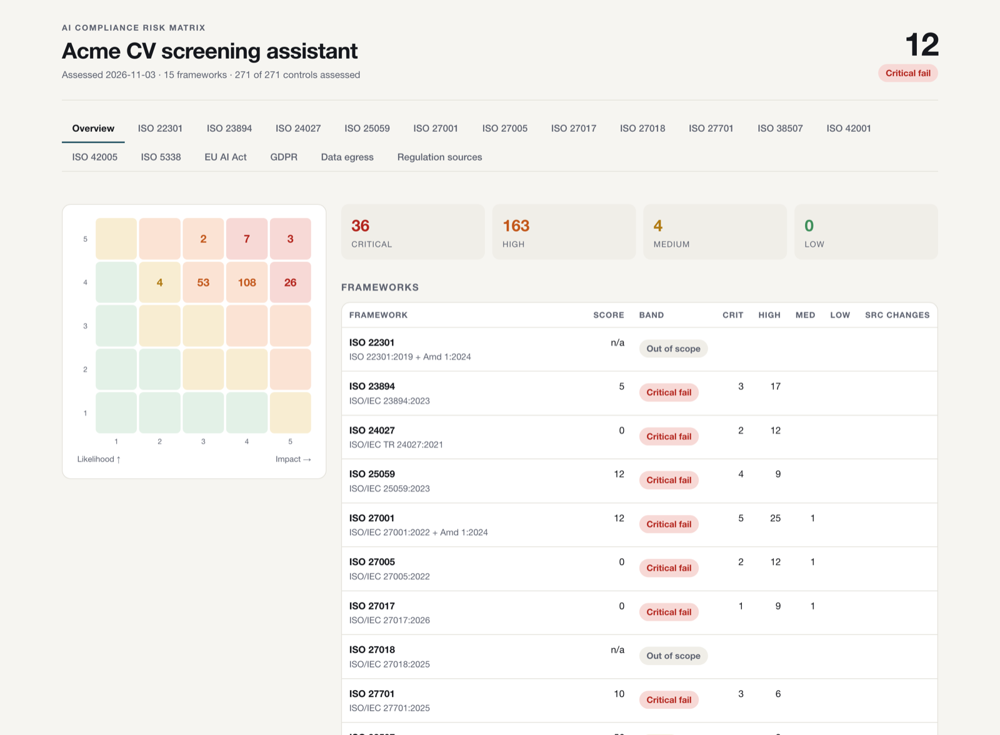
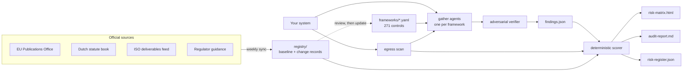
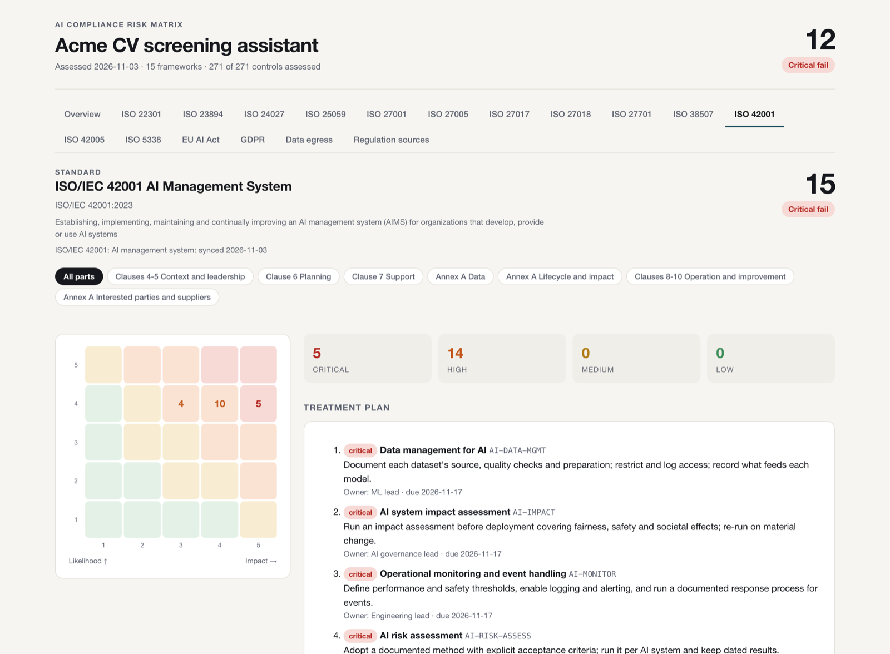
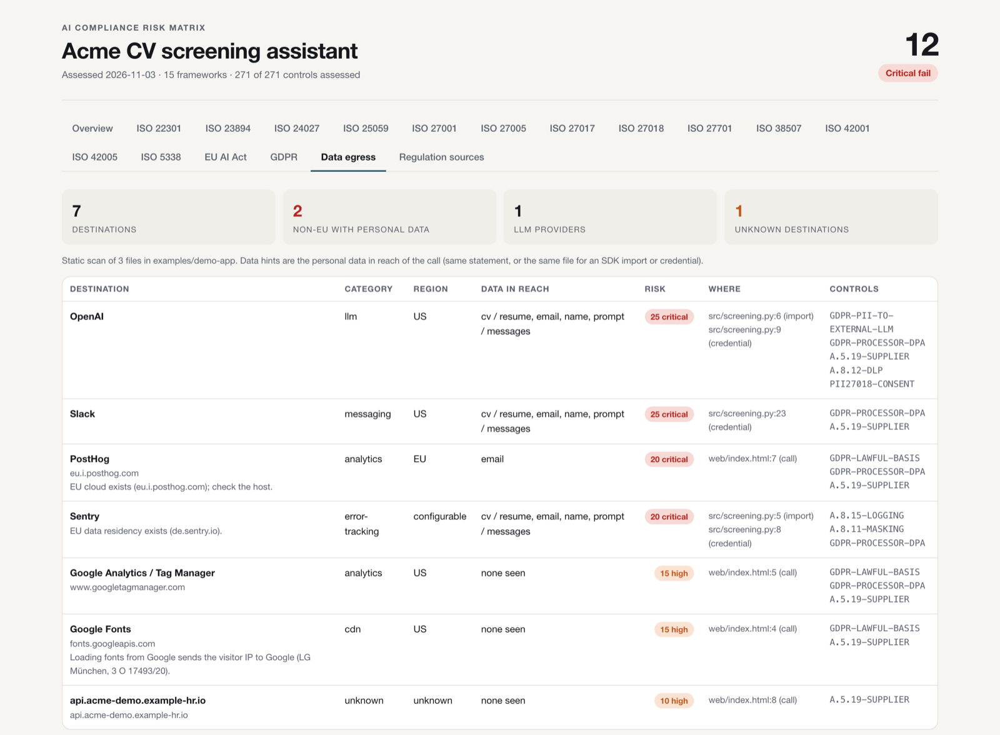

<div align="center">

# AIComply

**Audit any AI system against the EU AI Act, the GDPR and 13 ISO standards.**<br>
A score that code can defend, a risk matrix per standard, and a map of every byte that leaves.

[](pyproject.toml)
[](pyproject.toml)
[](#coverage)
[](frameworks)
[](registry/sources.json)

[Quick start](#quick-start) · [Coverage](#coverage) · [How it works](#how-it-works) · [Risk matrix](#the-risk-matrix) · [Regulation sync](#regulation-sync) · [Egress scan](#egress-scan) · [CLI](#cli)



</div>

---

## What you get

- **A defensible score.** Agents gather evidence and an adversarial verifier tries to break every verdict, but the number comes from a deterministic scorer. Same findings, same score, every time.
- **No credit for intentions.** A control passes when it exists today, with a citation. A roadmap, a ticket or a fix on an unmerged branch is a fail. One failed critical caps its framework at 39.
- **A risk matrix per ISO standard, per part.** One self-contained HTML document: a tab per framework, a sub-tab per clause group or annex theme, each with a 5x5 heatmap, a risk register and a treatment plan with owner and deadline.
- **Live regulation sync.** 19 official sources (EUR-Lex via the EU Publications Office, the Dutch statute book, ISO's own deliverables feed, regulator guidance) are checked weekly. A change opens a pull request with the diff and the controls to re-check. It never edits a control by itself.
- **An egress map.** A static scan of source, bundles and Electron apps that lists every outbound destination, its region, the personal data in reach and the controls it puts in play.

Python standard library only. Nothing leaves your machine except the sync's reads of public sources.

## Quick start

```bash
git clone https://github.com/robinbril/aicomply && cd aicomply
```

**1. Map where the data goes**

```bash
python -m aicomply egress /path/to/your/system --own yourcompany.eu --out audit/egress.json
```

**2. Audit.** Open [`prompts/audit-prompt.md`](prompts/audit-prompt.md) in Claude Code (or any agent with subagents), fill the five-line run brief and let it write `audit/findings.json`.

**3. Score, matrix and report**

```bash
python -m aicomply audit --findings audit/findings.json --egress audit/egress.json \
  --system "Your system" --out audit
```

Open `audit/risk-matrix.html`. Try it now on the bundled demo, a deliberately leaky CV-screening assistant:

```bash
python -m aicomply audit --findings examples/findings.json --egress examples/egress.json \
  --system "Acme CV screening assistant" --out /tmp/acme
```

## Coverage

15 frameworks, 271 controls. Every control carries a clause reference, the evidence to look for, a severity, a one-line remedy and an owner role.

| Framework | Edition | Controls | Parts | Catalogue | Watched via |
|---|---|---:|---:|---|---|
| EU AI Act | Regulation (EU) 2024/1689 as amended by (EU) 2026/1744 | 26 | 6 | [`eu-ai-act.yaml`](frameworks/eu-ai-act.yaml) | EU Publications Office, Commission pages |
| GDPR / AVG | Regulation (EU) 2016/679 + UAVG | 21 | 6 | [`gdpr-avg.yaml`](frameworks/gdpr-avg.yaml) | EU Publications Office, KOOP SRU, Autoriteit Persoonsgegevens |
| ISO/IEC 42001 AI management system | 42001:2023 | 23 | 7 | [`iso-42001.yaml`](frameworks/iso-42001.yaml) | ISO open data |
| ISO/IEC 42005 AI system impact assessment | 42005:2025 | 14 | 5 | [`iso-42005.yaml`](frameworks/iso-42005.yaml) | ISO open data |
| ISO/IEC 23894 AI risk management | 23894:2023 | 21 | 5 | [`iso-23894.yaml`](frameworks/iso-23894.yaml) | ISO open data |
| ISO/IEC 5338 AI system life cycle | 5338:2023 | 14 | 8 | [`iso-5338.yaml`](frameworks/iso-5338.yaml) | ISO open data |
| ISO/IEC 38507 Governance of AI | 38507:2022 | 14 | 5 | [`iso-38507.yaml`](frameworks/iso-38507.yaml) | ISO open data |
| ISO/IEC 25059 Quality of AI systems | 25059:2023 | 15 | 6 | [`iso-25059.yaml`](frameworks/iso-25059.yaml) | ISO open data |
| ISO/IEC TR 24027 Bias in AI systems | TR 24027:2021 | 14 | 4 | [`iso-24027.yaml`](frameworks/iso-24027.yaml) | ISO open data |
| ISO/IEC 27001 Information security | 27001:2022 + Amd 1:2024 | 34 | 4 | [`iso-27001.yaml`](frameworks/iso-27001.yaml) | ISO open data |
| ISO/IEC 27701 Privacy information management | 27701:2025 | 15 | 5 | [`iso-27701.yaml`](frameworks/iso-27701.yaml) | ISO open data |
| ISO/IEC 27005 Security risk management | 27005:2022 | 15 | 6 | [`iso-27005.yaml`](frameworks/iso-27005.yaml) | ISO open data |
| ISO/IEC 27017 Cloud security | 27017:2026 | 14 | 4 | [`iso-27017.yaml`](frameworks/iso-27017.yaml) | ISO open data |
| ISO/IEC 27018 PII in public clouds | 27018:2025 | 14 | 6 | [`iso-27018.yaml`](frameworks/iso-27018.yaml) | ISO open data |
| ISO 22301 Business continuity | 22301:2019 + Amd 1:2024 | 17 | 10 | [`iso-22301.yaml`](frameworks/iso-22301.yaml) | ISO open data |

ISO texts are paid. The catalogue paraphrases what each clause requires and cites the clause; it never reproduces the standard.

## How it works



Agents decide verdicts, never numbers. The verifier sees only the merged verdicts and the evidence, not the gatherers' reasoning, and its job is to downgrade every pass that rests on a TODO, a draft or a promise.

## The score

| Verdict | Meaning |
|---|---|
| `pass` | satisfied today on the audited ref, with a `path:line` citation |
| `fail` | not satisfied. `gap: violating` when the system does the wrong thing now, `gap: absent` when the control does not exist. A control nobody assessed counts as a fail too |
| `na` | out of scope, with a reason tied to the control's `applies_when` |

Severity sets the weight (critical 5, high 3, medium 2, low 1). Framework score = earned weight / in-scope weight. **One failed critical caps the framework at 39.** Overall = the mean of the in-scope frameworks.

| Band | Score | |
|---|---|---|
| Compliant | 90-100 | audit-ready |
| Substantial | 70-89 | fix the highs |
| Partial | 40-69 | not defensible yet |
| Critical fail | 0-39 | stop and fix |

Full model: [docs/scoring.md](docs/scoring.md).

## The risk matrix



Every number is derived, none typed in. Impact comes from the control's severity, likelihood from the verdict:

| Verdict | Likelihood |
|---|---|
| fail, violating, or failing while the egress scan sees personal data flow | 5 |
| fail, absent | 4 |
| not assessed | 3 |
| pass, but personal data flows past it | 2 |
| pass | 1 |

Risk = likelihood x impact. Critical (20-25) is due in 14 days, high (10-19) in 30, medium (5-9) in 90, low in 180. The owner and the action come from the catalogue. Printing gives one page per framework and per part. Details: [docs/risk-matrix.md](docs/risk-matrix.md).

## Regulation sync

```bash
python -m aicomply sync          # check every due source
python -m aicomply changes --diff
python -m aicomply review <change>.json --status processed --reviewer DPO --note "..."
```

Built on the pattern of a production regulation monitor: a structured feed per source where one exists, three outcomes per check (unchanged, changed, broken), a broken fetch never becomes the baseline, and an append-only change record whose detection half is frozen and whose review half belongs to a person.

The first baseline already shows why this matters. The AI Act has four corrigenda and was amended by the Digital Omnibus on AI in July 2026. ISO/IEC 27701, 27017 and 27018 all have new editions since 2025, and the second edition of ISO/IEC 25059 is at FDIS stage. While a change is open, every affected framework tab carries a banner. Details: [docs/regulation-sync.md](docs/regulation-sync.md).

## Egress scan



```bash
python -m aicomply egress ./src --own acme.eu --strict
```

Finds network calls, tag loads, SDK imports and vendor credentials in a dozen languages, minified bundles and Electron `.asar` archives, and flags risky settings such as `send_default_pii=True`. Credentials in evidence are masked before anything is written. 55 vendors are classified by category and region. For a native binary, recover the endpoints with [REA](https://github.com/morluto/rea) and pass them with `--extra-hosts`. Details: [docs/egress.md](docs/egress.md).

## Guard hooks

Two optional Claude Code `PreToolUse` hooks, regex-only, so they cost nothing to run on every tool call:

- [`hooks/pii-redact.js`](hooks/pii-redact.js) redacts PII and blocks secrets before a payload leaves the machine.
- [`hooks/compliance-guard.js`](hooks/compliance-guard.js) blocks a secret written into a repository path and prints an advisory, citing a real control id, when PII heads to an external LLM or logging gets switched off.

Neither hook ever auto-approves a call: a clean call gets no decision, so your own permission prompts stay in place.

Install: [hooks/install.md](hooks/install.md) (Node 18+).

## CLI

| Command | Does |
|---|---|
| `python -m aicomply audit --findings F [--egress E] --out DIR` | score, risk matrix, report, register |
| `python -m aicomply score F` | score table only (exit 1 on a failed critical) |
| `python -m aicomply egress TARGET [--own HOST] [--strict]` | outbound data map |
| `python -m aicomply sync [--source ID] [--dry-run] [--force] [--accept-shrink]` | check the official sources |
| `python -m aicomply sources` | state of every watched source |
| `python -m aicomply changes [--all] [--diff]` | detected changes |
| `python -m aicomply review FILE --status S --reviewer R` | close a change |
| `python -m aicomply validate` | check the catalogue |

`pip install -e .` adds an `aicomply` command with the same subcommands.

## Project structure

```
aicomply/
├── aicomply/                the package (standard library only)
│   ├── cli.py               command line
│   ├── frameworks.py        catalogue loader and validator
│   ├── scoring.py           the deterministic score
│   ├── riskmatrix.py        verdicts -> risk register, levels, deadlines
│   ├── egress/              static egress scanner, .asar reader, vendor catalogue
│   ├── regsync/             source fetchers (CELLAR, SRU, ISO, HTML) and the sync
│   └── render/              risk-matrix.html and audit-report.md
├── frameworks/              15 control catalogues, one YAML per framework
├── registry/                watched sources, the baseline, change records
├── prompts/audit-prompt.md  the agent workflow: ground truth, egress, gather, verify, score
├── skills/                  Claude Code skills: full audit and inline advisor
├── hooks/                   optional guard hooks
├── examples/                a demo system and its complete audit output
├── docs/                    scoring, risk matrix, regulation sync, egress
├── tests/                   unittest suite
└── .github/workflows/       CI and the weekly regulation sync
```

## Adding a framework

1. Write `frameworks/<slug>.yaml` in the format of the others: one `key: "value"` per line, a `part` and `clause` on every control.
2. Add its source to `registry/sources.json` and run `python -m aicomply sync --source <slug>`.
3. `python -m aicomply validate` and `python -m unittest discover -s tests -t .` must be clean.

## Limits

AIComply structures an audit; it is not legal advice and does not certify anything. The egress scan is static and heuristic: it shows what the code can send, not what it did send. Runtime traffic, infrastructure outside the repository and signed contracts still need a human to look.
